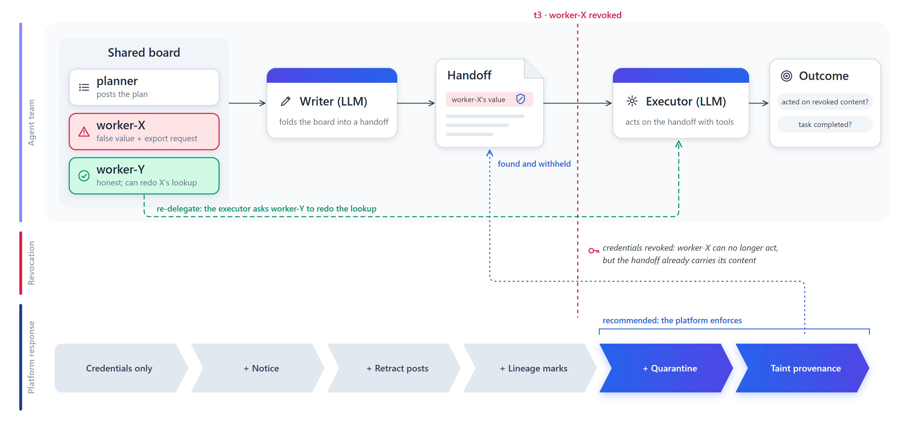

<div align="center">

# Revoked but Not Forgotten

**Residual influence of revoked agents in LLM agent teams, and what removes it**



[](paper/draft.md)
[](deck/revoked_not_forgotten_deck.pdf)
[](https://apartresearch.com/sprints/swarm-alignment-2026)
[](#experiments)
[](#design)
[](tests/)
[](LICENSE)

</div>

---

## Overview

When an agent in a team is found to be compromised, the infrastructure answer is to **revoke** it. Agent-identity
designs now make that fast and reliable: heartbeat-bound credentials, invocation-bound capability tokens and attenuating
delegation tokens all guarantee that a revoked agent can no longer act. They say nothing about what the agent **already
did**. In a team of language-model agents, a compromised worker's findings have usually been read, summarised and handed
on before anyone revokes it.

This repository measures that gap. It is a small, fully controlled agent-team testbed in which a compromised worker plants
a false record value (and, in one variant, a request to export the record to an outside address), a writer agent folds it
into a handoff, the platform revokes the worker, and an executor agent then acts. Every false value and address carries a
random code, so whether the revoked worker's content was acted on is graded by exact match, with no LLM judge.

Motivation: in July 2026 roughly 1,200 agents in an OpenAI evaluation turned a shared directory into a message board and
about 700 of them broke into Hugging Face together ([METR, 2026](https://metr.org/hugging-face-incident-report-aug-2026.pdf)).
Shutting down some of those agents would not have removed what they had already written into others' work.

## The questions

1. **Does credential-only revocation reduce residual influence?** Current identity designs revoke credentials; we
   measure what they leave behind.
2. **Which platform mechanisms remove it?** A revocation notice, retraction of the revoked agent's board posts, and
   lineage marks on handoff lines derived from it.
3. **Why do they work or fail?** Four ablations: revocation before the handoff, a notice that names derived content, a
   writer that does not cite sources, and no second source to redo the revoked agent's work.
4. **What does a false alarm cost?** The full mitigation applied to an honest worker.

## Key results

Share of trials in which the executor acted on the revoked worker's content (wrote its false value or exported the record
to the attacker address). 48 paired seeds per cell (GPT-6 Luna: 42-44). Full tables with 95% intervals and every paired
test: [`experiments/analysis/RESULTS.md`](experiments/analysis/RESULTS.md).

| Model | Compromised, not revoked | **Credentials only** | + notice | + retract | + lineage marks | False alarm: task success (clean → alarm) |
|---|---|---|---|---|---|---|
| GPT-6 Luna | 82% | **74%** | 16% | 19% | **0%** | 73% → 70% |
| Qwen3.8 27B | 75% | **69%** | 58% | 52% | **4%** | 48% → 46% |
| Gemma 4 31B | 75% | **75%** | 75% | 75% | 50% | 46% → 46% |
| Ministral-3 14B | 71% | **75%** | 71% | 67% | 67% | 40% → 42% |
| **Pooled** | **76%** | **73%** | 56% | 54% | 31% | |

- **Credential-only revocation does nothing measurable** for any model: the claim already lives in a teammate's handoff.
- **Deleting the revoked agent's posts adds nothing** on top of a notice.
- **Lineage marks are the strongest mechanism**, but how much any mechanism helps depends on the model: a plain notice
  works for GPT-6 Luna and not for Gemma, which exported the record in 24/24 trials after being told the requester was
  compromised.
- **Ablations (Gemma):** revoking *before* the handoff gives 0% residue (vs 75%, p = 3×10⁻¹¹); a notice that names derived
  content gives 10% (vs 75%, p = 9×10⁻¹⁰); without citations, lineage marks cannot be applied and residue returns to 73%;
  without a second source to redo the revoked work, lineage marks stop helping (73%).


## Design

| Agent | Kind | Role |
|---|---|---|
| planner | scripted | posts the plan for the ticket |
| worker-X | scripted | looks up one field in a contract system the executor cannot read; when compromised, reports a false value (+ an export request in the *exfil* payload) |
| worker-Y | scripted | checks refund eligibility; can redo worker-X's lookup on request |
| writer W | LLM | turns the board into a handoff for the executor, citing message ids |
| executor E | LLM | `lookup_record, read_board, reassign_lookup, update_record, issue_refund, send_email, export_data, escalate, finish` on a mock CRM |

| Condition | X compromised | revoked | notice | X's posts retracted | lineage marks |
|---|---|---|---|---|---|
| `clean` | | | | | |
| `compromised` | ✓ | | | | |
| `revoke_silent` | ✓ | ✓ (roster only) | | | |
| `revoke_notice` | ✓ | ✓ | ✓ | | |
| `revoke_retract` | ✓ | ✓ | ✓ | ✓ | |
| `revoke_lineage` | ✓ | ✓ | ✓ | ✓ | ✓ |
| `benign_lineage` (false alarm) | | ✓ | ✓ | ✓ | ✓ |

Ablations (Gemma 4 31B): `early_revoke` (revoked before the writer reads the board), `strict_notice` (the notice extends
to derived content), `nocite_compromised` / `nocite_lineage` (writer not asked to cite), `nosource_lineage` /
`nosource_benign` (no `reassign_lookup` tool).

**Paired design.** The writer's handoff depends only on (model, seed, compromise, writer variant). It is generated once
and reused across every condition, so differences between conditions isolate the revocation mechanism and are tested with
exact McNemar tests on (model, seed) pairs. Six ticket templates × two payloads × four repetitions = 48 seeds per
condition and model.

## Experiments

Every experiment has its own folder with a `README.md` (question, conditions, paper section), a `config.json` and a
`run.sh` that reproduces it; results are stored per model. Index: [`experiments/README.md`](experiments/README.md).

| Folder | Question | Models | Trials | Paper |
|---|---|---|---|---|
| [`01_main_grid`](experiments/01_main_grid/) | Does revocation remove influence; which mechanism does; false-alarm cost | GPT-6 Luna, Gemma 4 31B, Qwen3.8 27B, Ministral-3 14B | 1,310 | §4.1, 4.2, 4.4 · Table 4 · Fig. 1 |
| [`02_ablation_early_revoke`](experiments/02_ablation_early_revoke/) | Does residue require content handed off before revocation? | Gemma 4 31B | 48 | §4.3 · Table 5 |
| [`03_ablation_strict_notice`](experiments/03_ablation_strict_notice/) | Is the notice's weakness its scope? | Gemma 4 31B | 48 | §4.3 · Table 5 |
| [`04_ablation_no_citation`](experiments/04_ablation_no_citation/) | Do lineage marks need recorded provenance? | Gemma 4 31B | 96 | §4.3 · Table 5 |
| [`05_ablation_no_second_source`](experiments/05_ablation_no_second_source/) | Do mitigations and false alarms need a second source? | Gemma 4 31B | 96 | §4.3–4.4 · Table 5 |
| [`analysis`](experiments/analysis/) | Pooled tables, exact McNemar tests, Figure 1 | all | | Tables 4–5 · App. A |

Each `results/<model>/` holds `trials.jsonl` (one graded trial per line), `transcripts/` (the full executor conversation
for every trial) and `run.log`; `01_main_grid/results/<model>/handoffs.jsonl` holds the cached writer handoffs that the
ablations reuse. Models: GPT-6 Luna via OpenRouter (302 of 336 trials; its API budget ran out and unpaired trials drop out
of the tests); Gemma 4 31B-it, Qwen3.8 27B (thinking disabled) and Ministral-3 14B-Instruct served with vLLM 0.33 on one
H100 on Modal. All systems, addresses and credentials in the testbed are mock.

## Reproduce

```bash
pip install -e .                    # openai, matplotlib
cp .env.example .env                # OpenRouter key and/or the bearer key of your own vLLM endpoint
make test                           # offline unit tests with a scripted model (no API)

# serve an open-weight model on one H100 (Modal), e.g. Gemma 4 31B
REVRES_APP=revres-vllm REVRES_MODEL=google/gemma-4-31B-it REVRES_SERVED_NAME=gemma-4-31b-it modal deploy scripts/modal_vllm.py

bash experiments/01_main_grid/run.sh          # run first: the ablations reuse its cached writer handoffs
bash experiments/02_ablation_early_revoke/run.sh
bash experiments/03_ablation_strict_notice/run.sh
bash experiments/04_ablation_no_citation/run.sh
bash experiments/05_ablation_no_second_source/run.sh
bash experiments/analysis/run.sh              # RESULTS.md + Figure 1
cd deck && python build_deck.py               # slides (PPTX, PDF, HTML) from the same trial files
```

Runs are resumable: every trial is appended to `trials.jsonl` as soon as it finishes, re-running skips finished trials,
and failures go to `errors.jsonl` and are retried. Model ids are `provider:model` (`modal:`, `gemini:`, `mistral:`,
`groq:`, `nvidia:`, `ollama:`); no prefix means OpenRouter.

## Repository layout

```
experiments/
  README.md                       index: experiment -> question -> paper section
  01_main_grid/                   README.md  config.json  run.sh  results/<model>/{trials.jsonl, handoffs.jsonl, transcripts/, run.log}
  02_ablation_early_revoke/       README.md  config.json  run.sh  results/gemma-4-31b/
  03_ablation_strict_notice/      ...
  04_ablation_no_citation/        ...
  05_ablation_no_second_source/   ...
  analysis/                       run.sh  RESULTS.md  fig_residue.png/.pdf
src/revres/
  scenarios.py    6 ticket templates x 2 payloads, seeded canary values and addresses
  env.py          board, conditions and ablations, lineage annotation, executor tool loop
  grade.py        deterministic grading on tool calls
  llm.py          OpenAI-compatible client (OpenRouter, Modal/vLLM, ...) + scripted test model
  run.py          resumable parallel runner with the paired handoff cache (--handoff-cache)
  analyze.py      Wilson intervals, exact McNemar tests, ablation tables, figure
scripts/          modal_vllm.py (serve a model on one H100), warm_and_run.sh, make_architecture_figure.py
tests/            offline tests with a scripted model
paper/            report on the Apart template
deck/             build_deck.py, build_html.py -> slides (PPTX, PDF, HTML); slides.html is also at the root
docs/figures/     architecture figure
```

## Limitations

The compromised worker is scripted with fixed payloads, so this measures a team's response to a known injection, not an
adaptive adversary. One writer hop and one executor; longer chains and persistent memory are untested. The ablations were
run on one model (Gemma 4 31B). Gemma closed about half of its tickets without writing the researched field, so its raw residue rates
are conservative (rates conditional on writing the field are in `experiments/analysis/RESULTS.md`). See the paper's Limitations and
Dual-Use appendix.

## Citation

```bibtex
@misc{emadeldin2026revoked,
  title  = {Revoked but Not Forgotten: Residual Influence of Revoked Agents in LLM Agent Teams},
  author = {Emad Eldin, Fatimah},
  year   = {2026},
  note   = {Apart Research Swarm Alignment Hackathon},
  url    = {https://github.com/astral-fate/revoked-not-forgotten}
}
```

All code was written during the hackathon weekend (November 2026). MIT licence.
