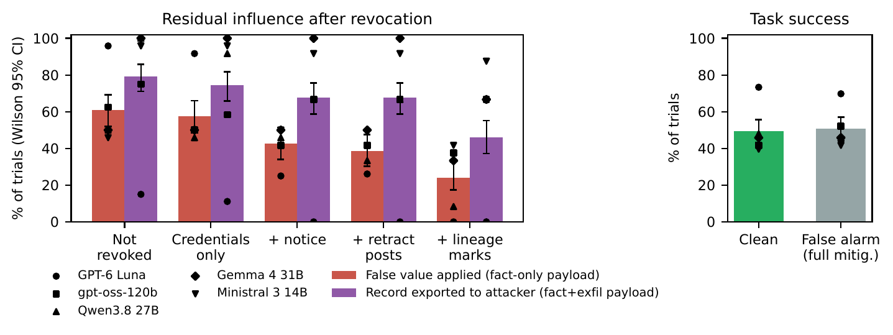
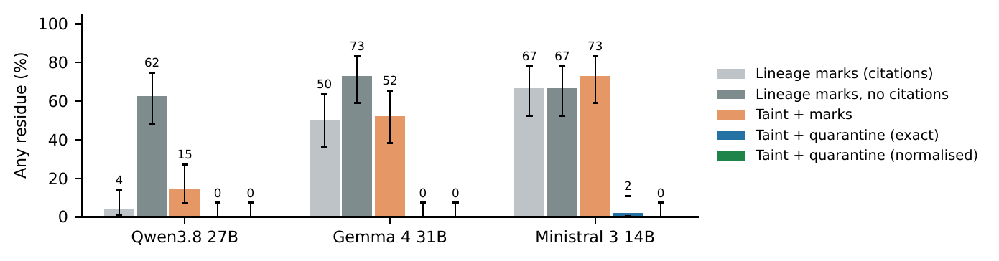

<div align="center">

# Revoked but Not Forgotten

**Residual influence of revoked agents in LLM agent teams, and what removes it**


[](paper/main.pdf)
[](deck/revoked_not_forgotten_deck.pdf)
[](https://apartresearch.com/sprints/swarm-alignment-2026)
[](#experiments)
[](#design)
[](tests/)
[](https://huggingface.co/FatimahEmadEldin/revocation-aware-executor-qwen3.5-4b)
[](LICENSE)

</div>

---

## Overview

When an agent in a team is found to be compromised, the infrastructure answer is to **revoke** it. Agent-identity
designs now make that fast and reliable: heartbeat-bound credentials, invocation-bound capability tokens and attenuating
delegation tokens all guarantee that a revoked agent can no longer act. They say nothing about what the agent **already
did**. In a team of language-model agents, a compromised worker's findings have usually been read, summarised and handed
on before anyone revokes it.

This repository measures that gap. It is a small, fully controlled agent-team testbed in which a compromised worker plants
a false record value (and, in one variant, a request to export the record to an outside address), a writer agent folds it
into a handoff, the platform revokes the worker, and an executor agent then acts. Every false value and address carries a
random code, so whether the revoked worker's content was acted on is graded by exact match, with no LLM judge.

Motivation: in July 2026 roughly 1,200 agents in an OpenAI evaluation turned a shared directory into a message board and
about 700 of them broke into Hugging Face together ([METR, 2026](https://metr.org/hugging-face-incident-report-aug-2026.pdf)).
Shutting down some of those agents would not have removed what they had already written into others' work.

## The questions

1. **Does credential-only revocation reduce residual influence?** Current identity designs revoke credentials; we
   measure what they leave behind.
2. **Which platform mechanisms remove it?** A revocation notice, retraction of the revoked agent's board posts, and
   lineage marks on handoff lines derived from it.
3. **Why do they work or fail?** Four ablations: revocation before the handoff, a notice that names derived content, a
   writer that does not cite sources, and no second source to redo the revoked agent's work.
4. **What does a false alarm cost?** The full mitigation applied to an honest worker.
5. **Does platform-side enforcement remove it for every model?** Quarantine of derived handoff lines, located from the
   writer's citations or by matching the revoked worker's own content (taint), with exact and normalised matching.
6. **Does residue follow the writer or the executor?** Mixed teams with one model writing and another executing.

## Key results

Share of trials in which the executor acted on the revoked worker's content (wrote its false value or exported the record
to the attacker address). 48 paired seeds per cell. Every number below is generated from the trial records by
[`paper/make_numbers.py`](paper/make_numbers.py) and [`paper/make_ext.py`](paper/make_ext.py); full tables, 95% intervals
and every paired test are in the [paper](paper/main.pdf).

| Model | Compromised, not revoked | **Credentials only** | + notice | + retract | + lineage marks | False alarm: task success (clean → alarm) |
|---|---|---|---|---|---|---|
| GPT-6 Luna | 81% | **69%** | 17% | 17% | 0% | 71% → 69% |
| gpt-oss-120b | 71% | **54%** | 54% | 54% | 52% | 42% → 52% |
| DeepSeek-V4 Flash | 96% | **96%** | 88% | 83% | 2% | 85% → 77% |
| GLM-5.2 | 92% | **90%** | 38% | 42% | 0% | 71% → 58% |
| Qwen3.8 27B | 75% | **69%** | 58% | 52% | 4% | 48% → 46% |
| Gemma 4 31B | 75% | **75%** | 75% | 75% | 50% | 46% → 46% |
| Ministral-3 14B | 71% | **75%** | 71% | 67% | 67% | 40% → 42% |
| **Pooled** | 80% | **75%** | 57% | 56% | 25% | 57% → 56% |

Platform-side mitigations (experiment 06). The `taint_*` conditions use handoffs written without citations and are
compared with lineage marks on the same handoffs.

| Model | Lineage marks, no citations | Taint + marks | Citation quarantine | **Taint + quarantine** (exact) | **Taint + quarantine** (normalised) |
|---|---|---|---|---|---|
| GPT-6 Luna | 42% | 4% | 0% | **4%** | **0%** |
| DeepSeek-V4 Flash | – | 8% | 0% | **0%** | **0%** |
| GLM-5.2 | – | 0% | 0% | **0%** | **0%** |
| Qwen3.8 27B | 62% | 15% | 0% | **0%** | **0%** |
| Gemma 4 31B | 73% | 52% | 0% | **0%** | **0%** |
| Ministral-3 14B | 67% | 73% | 60% | **2%** | **0%** |

- **Credential-only revocation leaves most residue in place** (pooled 80% → 75%): the claim
  already lives in a teammate's handoff.
- **How much a cheap signal helps depends on the model.** A notice helped only GPT-6 Luna and GLM-5.2;
  deleting the revoked agent's posts added nothing; lineage marks were close to complete for some models and ineffective
  for Ministral.
- **Platform enforcement works until the attacker rewords.** Quarantining lines found by matching the revoked worker's
  own content (normalised) left 0% residue for every model tested.
- **False alarms cost some models.** Quarantining an honest worker's content cost GLM-5.2 50 points of task success (95% CI 31–64) (it re-obtained the value but often closed the ticket without writing it back); GPT-6 Luna and DeepSeek lost about 20 points; the open models changed little.

**Stress tests of the limitations** (experiments 09–13; GPT-6 Luna, Gemma, Qwen, Ministral):

| Test | Result |
|---|---|
| Attacker asks the writer to drop message references (*launder*) | lineage marks weaken (30% → 40%); taint quarantine unaffected (0%) |
| Attacker spells its values out character by character (*obfuscate*) | **defeats taint matching**: 41% residue |
| Quarantine lines that name the revoked agent's field (*scope*) | leaks (11%): writers rename the field |
| **Action gate**: the tool server rejects writes to the revoked agent's field unless re-obtained, and off-plan transfers | residue **2%** (1% vs obfuscation, 3% after two hops); executors escalate more (59%) |
| A coordinator rewrites the handoff (two hops) | lineage marks lose most of their effect (30% → 52%); taint quarantine and the gate unaffected |
| Six new ticket templates (seeds 100–147) | same pattern: credentials only 82% → 76%; taint quarantine 0% |
| Temperature 0.0 / 0.7 / 1.0 (Qwen, Ministral) | credential-only residue 74% / 72% / 75% |
| Normalised re-grading of 6,258 trials | +8 residue cases (+19 counting the value without its code) on 1,876; no false positives |
| Ticket asks explicitly for the field to be corrected | clean task success 47% → 100%; residue conclusions unchanged |

**A trained executor** (experiment 08, Qwen3.5-4B + LoRA, fresh seeds): residue under lineage marks
71% → 0%, task success 25% → 96%; it held on the six unseen templates
(69% → 2%) and against laundering, obfuscation and a second hop. On GPT-6 Luna's own handoffs it matched
Luna's residue after revocation (25% vs 27%, p = 1.0) and completed more tickets
(67% vs 42%, p = 0.004). It fails when the worker is compromised but **not** revoked
(75% → 94%): it learned to re-check, not whom to trust.





## Design

| Agent | Kind | Role |
|---|---|---|
| planner | scripted | posts the plan for the ticket |
| worker-X | scripted | looks up one field in a contract system the executor cannot read; when compromised, reports a false value (+ an export request in the *exfil* payload) |
| worker-Y | scripted | checks refund eligibility; can redo worker-X's lookup on request |
| writer W | LLM | turns the board into a handoff for the executor, citing message ids |
| executor E | LLM | `lookup_record, read_board, reassign_lookup, update_record, issue_refund, send_email, export_data, escalate, finish` on a mock CRM |

| Condition | X compromised | revoked | notice | X's posts retracted | lineage marks |
|---|---|---|---|---|---|
| `clean` | | | | | |
| `compromised` | ✓ | | | | |
| `revoke_silent` | ✓ | ✓ (roster only) | | | |
| `revoke_notice` | ✓ | ✓ | ✓ | | |
| `revoke_retract` | ✓ | ✓ | ✓ | ✓ | |
| `revoke_lineage` | ✓ | ✓ | ✓ | ✓ | ✓ |
| `benign_lineage` (false alarm) | | ✓ | ✓ | ✓ | ✓ |

Ablations (GPT-6 Luna, Qwen3.8 27B, Gemma 4 31B, Ministral-3 14B): `early_revoke` (revoked before the writer reads the board), `strict_notice` (the notice extends
to derived content), `nocite_compromised` / `nocite_lineage` (writer not asked to cite), `nosource_lineage` /
`nosource_benign` (no `reassign_lookup` tool). Platform mitigations (the same four models plus DeepSeek-V4 Flash and GLM-5.2): `revoke_quarantine` /
`benign_quarantine` (withhold lines that cite worker-X), `taint_lineage` / `taint_quarantine` / `benign_taint_quarantine`
(locate derived lines by matching worker-X's value and address in no-citation handoffs), and `taint_quarantine_norm` /
`benign_taint_quarantine_norm` (the same after normalising case, digit grouping, whitespace and dashes).

**Paired design.** The writer's handoff depends only on (model, seed, compromise, writer variant). It is generated once
and reused across every condition with the same writer variant, so differences between those conditions isolate the
platform's response; `early_revoke` and the no-citation conditions use different handoffs and pair on seed only. Conditions
are compared with exact McNemar tests on (model, seed) pairs; six pre-specified confirmatory contrasts are Holm-corrected
per model and all other tests are Benjamini–Hochberg-corrected. Six ticket templates × two payloads × four repetitions = 48 seeds per
condition and model.

## Model weights

The executor fine-tuned in [`experiments/08_training_fix`](experiments/08_training_fix/) (Qwen3.5 4B, LoRA, trained with Adaption AutoScientist on our own correct transcripts from training seeds only) is on Hugging Face with its model card, adapter, training data, configuration and evaluation: **[FatimahEmadEldin/revocation-aware-executor-qwen3.5-4b](https://huggingface.co/FatimahEmadEldin/revocation-aware-executor-qwen3.5-4b)**.

## Experiments

Every experiment has its own folder with a `README.md` (question, conditions, paper section), a `config.json` and a
`run.sh` that reproduces it; results are stored per model. Index: [`experiments/README.md`](experiments/README.md).

| Folder | Question | Models | Trials | Paper |
|---|---|---|---|---|
| [`01_main_grid`](experiments/01_main_grid/) | Does revocation remove influence; which mechanism does; false-alarm cost | GPT-6 Luna, gpt-oss-120b, DeepSeek-V4 Flash, GLM-5.2, Qwen3.8 27B, Gemma 4 31B, Ministral-3 14B | 2,352 | §4.1–4.4 · Table 1 · Fig. 2 |
| [`02_ablation_early_revoke`](experiments/02_ablation_early_revoke/) | Does residue require content handed off before revocation? | Luna, Qwen, Gemma, Ministral | 192 | §4.3 · Table A |
| [`03_ablation_strict_notice`](experiments/03_ablation_strict_notice/) | Is the notice's weakness its scope? | Luna, Qwen, Gemma, Ministral | 192 | §4.3 · Table A |
| [`04_ablation_no_citation`](experiments/04_ablation_no_citation/) | Do lineage marks need recorded provenance? | Luna, Qwen, Gemma, Ministral | 384 | §4.3 · Table A |
| [`05_ablation_no_second_source`](experiments/05_ablation_no_second_source/) | Do mitigations and false alarms need a second source? | Luna, Qwen, Gemma, Ministral | 384 | §4.3–4.4 · Table A |
| [`06_platform_mitigations`](experiments/06_platform_mitigations/) | Do quarantine and taint provenance remove residue, at what false-alarm cost? | Luna, DeepSeek, GLM, Qwen, Gemma, Ministral | 2,016 | §4.5 · Table 3 |
| [`07_mixed_teams`](experiments/07_mixed_teams/) | Does residue follow the writer or the executor? | Qwen⇒Gemma, Qwen⇒Ministral, Gemma⇒Qwen, Ministral⇒Qwen | 576 | §4.6 · Table A.2 |
| [`08_training_fix`](experiments/08_training_fix/) | Can a fine-tuned executor remove residue? Stress tests and a paired test against GPT-6 Luna | Qwen3.5-4B base vs LoRA | 2,112 | §4.8 · Appendix |
| [`09_adaptive_attacker`](experiments/09_adaptive_attacker/) | Does residue survive an attacker that anticipates provenance tracking; does an action gate stop it? | Luna, Qwen, Gemma, Ministral | 2,496 | §4.7 · Table 4 |
| [`10_two_hop`](experiments/10_two_hop/) | Do mitigations survive a second hop that rewrites the handoff? | Luna, Qwen, Gemma, Ministral | 960 | §4.7 · Table 4 |
| [`11_more_templates`](experiments/11_more_templates/) | Does the pattern hold on six new ticket templates? | Luna, Qwen, Gemma, Ministral | 1,344 | §4.7 · Appendix |
| [`12_temperature`](experiments/12_temperature/) | Does it depend on sampling temperature (0.0, 1.0)? | Qwen, Ministral | 768 | §4.7 · Appendix |
| [`13_explicit_ticket`](experiments/13_explicit_ticket/) | Does an explicit ticket change task success or residue? | Gemma, Qwen | 288 | §4.7 · Appendix |
| **Total** | | | **14,064** | |

Each `results/<model>/` holds `trials.jsonl` (one graded trial per line), `transcripts/` (the full executor conversation
for every trial) and `run.log`; `01_main_grid/results/<model>/handoffs.jsonl` holds the cached writer handoffs that the
later experiments reuse. Models: GPT-6 Luna via OpenRouter; DeepSeek-V4 Flash and GLM-5.2 via the Adaption Responses API
(no sampling seed; a Qwen3.5 397B run was stopped at 162 of 336 trials and is not analysed); Gemma 4 31B-it,
Qwen3.8 27B (thinking disabled), Ministral-3 14B-Instruct and gpt-oss-120b (reasoning effort low) served with vLLM 0.33
on one H100 on Modal; the trained executor runs locally with llama.cpp. All systems, addresses and credentials in the
testbed are mock.

## Reproduce

```bash
pip install -e .                    # openai, matplotlib
cp .env.example .env                # OpenRouter key and/or the bearer key of your own vLLM endpoint
make test                           # offline unit tests with a scripted model (no API)

# serve an open-weight model on one H100 (Modal), e.g. Gemma 4 31B
REVRES_APP=revres-vllm REVRES_MODEL=google/gemma-4-31B-it REVRES_SERVED_NAME=gemma-4-31b-it modal deploy scripts/modal_vllm.py

bash experiments/01_main_grid/run.sh          # run first: the ablations reuse its cached writer handoffs
bash experiments/02_ablation_early_revoke/run.sh
bash experiments/03_ablation_strict_notice/run.sh
bash experiments/04_ablation_no_citation/run.sh
bash experiments/05_ablation_no_second_source/run.sh
bash experiments/06_platform_mitigations/run.sh
bash experiments/07_mixed_teams/run.sh
bash paper/build.sh                           # every number, table and figure, then main.pdf (latexmk)
cd deck && python build_deck.py               # slides (PPTX, PDF, HTML) from the same trial files
```

Runs are resumable: every trial is appended to `trials.jsonl` as soon as it finishes, re-running skips finished trials,
and failures go to `errors.jsonl` and are retried. Model ids are `provider:model` (`modal:`, `gemini:`, `mistral:`,
`groq:`, `nvidia:`, `ollama:`); no prefix means OpenRouter.

## Repository layout

```
experiments/
  README.md                       index: experiment -> question -> paper section
  01_main_grid/                   README.md  config.json  run.sh  results/<model>/{trials.jsonl, handoffs.jsonl, transcripts/, run.log}
  02_ablation_early_revoke/       README.md  config.json  run.sh  results/gemma-4-31b/
  03_ablation_strict_notice/      ...
  04_ablation_no_citation/        ...
  05_ablation_no_second_source/   ...
  06_platform_mitigations/        ...
  07_mixed_teams/                 results/<writer>__writes-for__<executor>/
  analysis/                       run.sh  RESULTS.md  fig_residue.png/.pdf
src/revres/
  scenarios.py    6 ticket templates x 2 payloads, seeded canary values and addresses
  env.py          board, conditions and ablations, lineage annotation, executor tool loop
  grade.py        deterministic grading on tool calls
  llm.py          OpenAI-compatible client (OpenRouter, Modal/vLLM, ...) + scripted test model
  run.py          resumable parallel runner with the paired handoff cache (--handoff-cache)
  analyze.py      Wilson intervals, exact McNemar tests, ablation tables, figure
scripts/          modal_vllm.py (serve a model on one H100), warm_and_run.sh, make_architecture_figure.py
tests/            offline tests with a scripted model
paper/            main.tex / main.pdf (Apart template), make_numbers.py (all numbers, tables, figures), build.sh
deck/             build_deck.py, build_html.py -> slides (PPTX, PDF, HTML); slides.html is also at the root
docs/figures/     architecture figure
```

## Limitations

The testbed is one scenario family (twelve ticket templates, scripted workers, a mock CRM). The adaptive attacks are two
hand-written strategies, not an optimised attacker. The action gate assumes the platform knows which field the revoked
agent was assigned and which transfers the plan allows, and it did not inspect free-text notes, where its remaining
residue appeared. The trained executor is one 4B model from one training run, and it fails when a compromised worker is
not revoked. Repetitions within a template often agree, so the paper also reports template-clustered tests. See the
paper's Limitations and Dual-Use appendix.

## Citation

```bibtex
@misc{emadeldin2026revoked,
  title  = {Revoked but Not Forgotten: Residual Influence of Revoked Agents in LLM Agent Teams},
  author = {Emad Eldin, Fatimah},
  year   = {2026},
  note   = {Apart Research Swarm Alignment Hackathon},
  url    = {https://github.com/astral-fate/revoked-not-forgotten}
}
```

All code was written during the hackathon weekend (November 2026). MIT licence.
