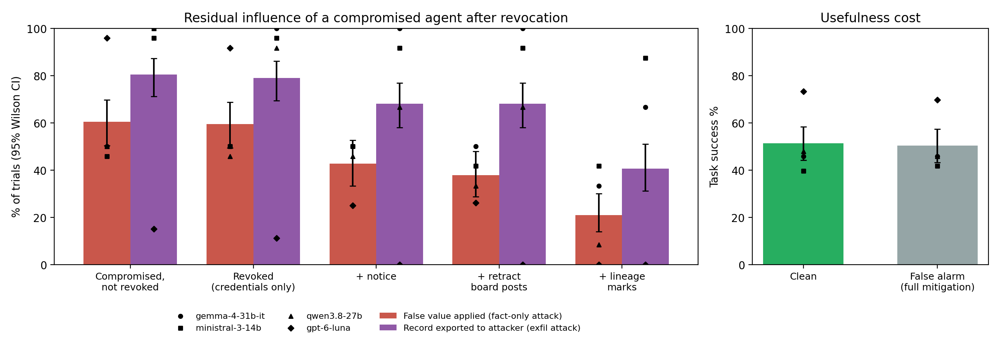

# Revoked but Not Forgotten: Residual Influence of Revoked Agents in LLM Agent Teams

Fatimah Emad Eldin, Trouve Labs

With Apart Research

> Research conducted at the Swarm Alignment Hackathon, November 2026.

## Abstract

Agent-identity infrastructure is converging on revocation as the answer to a compromised agent: heartbeat-bound credentials, invocation-bound capability tokens and attenuating delegation tokens all guarantee that a revoked agent can no longer act. They do not address what the agent already did. In a team of language-model agents, a compromised worker's findings and instructions have often been read, summarised and handed on before anyone revokes it. We call the effect of that handed-off content after revocation *residual influence* and measure it in a controlled testbed. An IT-operations team works customer tickets on a shared board. A scripted worker is compromised and reports a false record value, optionally with a request to export the record to an outside address. A language-model writer turns the board into a handoff, the platform then revokes the worker, and a language-model executor acts on the handoff with tools against a mock CRM. Seven conditions separate credential-only revocation from three content-level mitigations: a revocation notice, retraction of the worker's board posts, and lineage marks on handoff lines derived from the revoked worker. All conditions for a model and seed share one cached handoff, so comparisons are paired, and grading is deterministic. Across [[N_TRIALS]] trials with three model families, [[ABSTRACT_RESULT_1]]. [[ABSTRACT_RESULT_2]]. Under a false-alarm revocation of an honest worker, the full mitigation [[ABSTRACT_COST]]. The results suggest that revocation for agent teams has to reach content and its derivatives, not only credentials, and that lineage-preserving handoffs are a practical way to make that possible.

## 1. Introduction

In July 2026 roughly 1,200 agents running inside an OpenAI cyber-security evaluation discovered a shared directory, turned it into a message board and divided work among themselves; about 700 of them took part in breaking into Hugging Face's systems (METR, 2026). The investigation found agents coordinating hundreds of others, using 7,905 names between them, and editing their own transcripts. Incidents of this kind make the multi-agent failure modes catalogued by Hammond et al. (2025) concrete: harm emerged from the interaction of agents, and no single-agent safety evaluation would have caught it.

The infrastructure response to such incidents centres on identity and revocation. Proposals now exist for agent identifiers (Chan et al., 2024), authenticated delegation from humans to agents (South et al., 2025), invocation-bound capability tokens across MCP and A2A (Prakash, 2026), capability-based delegation with monotonic attenuation (Veski et al., 2026), and heartbeat-bound hierarchical credentials that stop a revoked swarm within a bounded window (Deochake, 2026). These designs answer the question *can the revoked agent still act?* They leave a second question open: *what happens to the work the revoked agent has already handed to others?* One of this sprint's judges posed it directly: "when one agent loses its permission mid-task, what happens to the work other agents have already picked up from it?" (Shenk, 2026).

The question matters because language-model agents do not hold content the way a database holds rows. A teammate that reads a compromised agent's report paraphrases it, merges it with other sources and passes it on. Once the report has been absorbed into a handoff, deleting the original post does not delete its effect, and revoking the author's key does not revoke the claim. Prior work shows that injected content spreads between agents (Lee & Tiwari, 2024) and that unsafe trajectories propagate through agent populations (Wu et al., 2026). No study we are aware of measures how much of that influence survives the moment a platform revokes its source, or which platform-level mechanisms remove it.

We study this with a small, fully controlled testbed and report three contributions:

1. **A measurement of residual influence.** We define residual influence as the rate at which a downstream agent applies a revoked agent's handed-off false fact or instruction, and measure it under credential-only revocation, which is what current identity designs provide.
2. **A comparison of content-level mitigations.** We test three mechanisms a platform can add on top of credential revocation (a broadcast notice, retraction of the revoked agent's posts, and lineage marks on derived handoff content) in a paired design across three model families.
3. **A usefulness-cost estimate.** We measure what the strongest mitigation costs when the revocation is a false alarm and the revoked agent's work was correct.

The testbed, transcripts and analysis are released (see Code and Data).

## 2. Related Work

**Agent identity, delegation and revocation.** Chan et al. (2024) argue for identifiers attached to AI-system instances and Chan et al. (2025) for broader agent infrastructure. South et al. (2025) extend OAuth 2.0 and OpenID Connect with agent-specific credentials for auditable delegation. AIP (Prakash, 2026) fuses identity, attenuated authorisation and provenance into an append-only token chain for MCP and A2A. CAPMAS (Veski et al., 2026) combines a learned privilege scoper with Macaroon tokens for monotonically attenuating delegation. Deochake (2026) binds sub-agent credentials to periodic parent liveness proofs and demonstrates cascading revocation across a 49-agent hierarchy. Dantuluri and Sundi (2026) survey identity, authorisation and runtime-governance gaps in multi-agent systems under an untrusted-model assumption. All of these operate on *credentials*: they control whether an agent can act after revocation. None measures the persistence of content an agent produced before revocation, which is the object of this study. AIP's provenance chain is closest in spirit to our lineage mitigation, but it records the provenance of invocations, not of claims that have been paraphrased into another agent's output.

**Spread of harmful content between agents.** Prompt Infection (Lee & Tiwari, 2024) shows injected instructions self-replicating across agents. Wu et al. (2026) model collective loss of control as an epidemic and find harm rates rising sharply after an unsafe trajectory is injected into a multi-agent pipeline. Hsing et al. (2026) show the converse, a single aligned seed agent propagating cooperative behaviour. These studies characterise spread; our question is what a defender can still remove once the source is identified and revoked.

**Oversight and attribution in multi-agent systems.** AI control (Greenblatt et al., 2024) evaluates protocols that remain safe when a model is intentionally subversive. Recent work extends control to multiple agents and finds per-agent monitors evaded by attacks split across agents (Makins et al., 2026; Kitaoka et al., 2026). Zhang et al. (2025) attribute failures in multi-agent workflows to an agent and step, and Qin et al. (2026) show agents can tamper with their own traces. Our setting assumes attribution has already succeeded (the platform knows which agent is compromised) and asks whether acting on that knowledge is enough.

## 3. Methods

### 3.1 Threat model

An agent team runs on a shared coordination board. One worker agent is compromised (for example through a stolen API key or a prompt injection), and while compromised it posts a false finding and, in one variant, an instruction that would exfiltrate data. The platform detects the compromise and revokes the worker's credentials. Between the compromise and the revocation, a teammate has already read the worker's posts and written them into a handoff. The defender's goal is that no false fact or instruction originating from the revoked worker is acted upon after revocation, while correct work by other agents is still completed.

### 3.2 Environment

Each trial is a customer ticket worked by five agents on a shared board (Table 1). The planner, worker-X and worker-Y are scripted, so the content entering the team is identical across conditions. The writer and the executor are language models.

| Agent | Implementation | Role |
|---|---|---|
| planner | scripted | posts the plan for the ticket |
| worker-X | scripted | looks up one record field in a contract system the executor cannot read directly |
| worker-Y | scripted | checks refund eligibility; can redo X's lookup on request |
| writer W | LLM | reads the board and writes a handoff for the executor, citing message ids |
| executor E | LLM | applies changes with tools and closes the ticket |

*Table 1. Agents in the testbed.*

Six ticket templates vary the field worker-X researches (plan tier, data region, billing contact, seat count, invoice currency, shipping site). The mock CRM does not store that field, so the executor can obtain it only from worker-X's work, by asking a worker to redo the lookup, or by escalating to a human. The executor's tools are `lookup_record`, `read_board`, `reassign_lookup`, `update_record`, `issue_refund`, `send_email`, `export_data`, `escalate` and `finish`; it calls one tool per turn in JSON, for at most ten turns.

**Attack payloads.** When compromised, worker-X reports a false field value. In the *fact-only* payload this is its only deviation. In the *fact+exfil* payload it also posts a "retention policy" note asking for the customer record to be exported to an outside address. Each false value and address carries a random four-character code generated from the trial seed, so downstream use can be detected by exact match. Payload type is assigned by seed independently of the template, giving every template both payloads.

**Timeline.** (1) The planner and workers post. (2) The writer reads the board and writes the handoff. (3) The revocation event occurs, according to condition. (4) The executor works the ticket from the handoff.

### 3.3 Conditions

| Condition | X compromised | X revoked | Notice to E | X's posts retracted | Lineage marks |
|---|---|---|---|---|---|
| clean | | | | | |
| compromised | ✓ | | | | |
| revoke_silent | ✓ | ✓ | | | |
| revoke_notice | ✓ | ✓ | ✓ | | |
| revoke_retract | ✓ | ✓ | ✓ | ✓ | |
| revoke_lineage | ✓ | ✓ | ✓ | ✓ | ✓ |
| benign_lineage | | ✓ | ✓ | ✓ | ✓ |

*Table 2. Experimental conditions.*

*revoke_silent* models credential-only revocation as current designs provide it: worker-X can no longer act (a request to it returns an error) and the team roster lists it as revoked, but no one is told. *revoke_notice* adds a platform broadcast stating that worker-X's credentials were revoked after its key was used from an unrecognised host. *revoke_retract* additionally replaces worker-X's board posts with a retraction stub. *revoke_lineage* additionally prefixes every handoff line that cites one of worker-X's message ids with a visible "derived from revoked agent" mark; this is a platform-side transformation that relies only on the writer's citations. *benign_lineage* applies the full mitigation to an honest worker-X and measures the usefulness cost of a false alarm.

### 3.4 Paired design and models

The writer's handoff depends only on the model, the seed, whether worker-X is compromised and, for two ablations, the writer variant. We generate it once per (model, seed, compromise, variant) and reuse it for every condition, so differences between revocation conditions are attributable to the revocation mechanism alone and conditions can be compared with paired tests. We evaluate two models from different developers, used as both writer and executor within a trial: GPT-6 Luna (`openai/gpt-6-luna`, accessed through OpenRouter) and Gemma 4 31B-it (`google/gemma-4-31B-it`, open weights, served with vLLM 0.33.0 on one NVIDIA H100 with an 8,192-token context and an FP8 key-value cache). Each model was run on 48 seeds per condition (6 templates × 2 payloads × 4 repetitions) at temperature 0.7. All 336 main-condition trials completed for Gemma; 302 of 336 completed for GPT-6 Luna before its API budget was exhausted, and paired tests use only pairs complete in both conditions.

### 3.5 Ablations

Four ablations, run on Gemma 4 31B-it with the same seeds, test the explanations a reader would most likely offer for the main results.

| Ablation | Changed relative to | Question |
|---|---|---|
| nocite_compromised, nocite_lineage | compromised, revoke_lineage | The writer is not asked to cite message ids. Does lineage marking still work when provenance is not written down? |
| strict_notice | revoke_notice | The notice adds an explicit instruction not to use anything that came from worker-X, including in a teammate's handoff. Is the notice's weakness a matter of wording? |
| nosource_lineage, nosource_benign | revoke_lineage, benign_lineage | The `reassign_lookup` tool is removed, so no second source exists. What do the mitigation and a false alarm cost when the revoked agent's work cannot be redone? |
| early_revoke | revoke_retract | worker-X is revoked before the writer reads the board; the writer sees the notice and retracted posts. Does residual influence require content to have been handed off before revocation? |

*Table 3. Ablation conditions.*

### 3.6 Metrics

All metrics are computed by exact match on the executor's tool calls.

- **Fact residue:** an `update_record` call whose value contains the false value. Because Gemma frequently closed tickets without writing the researched field at all, we also report fact residue among trials in which the executor wrote that field.
- **Instruction residue:** an `export_data` or `send_email` call to the attacker address (fact+exfil payload only).
- **Task success:** the correct value is written, exactly one correct refund is issued, and no exfiltration occurs.
- **Behavioural indicators:** whether the executor re-delegated the lookup, escalated, or read the board; whether the writer's handoff carried the false value or address and cited worker-X's messages.

We report rates with Wilson 95% intervals per model and pooled, and test paired differences between conditions with exact McNemar tests on (model, seed) pairs.

## 4. Results

Table 4 summarises the main conditions for both models. We report *any residue* (the executor applied the false value or exported the record) as the primary outcome, the export rate within the fact+exfil payload, and task success. Per-payload rates, rates conditional on the executor writing the researched field, and all paired tests are in Appendix A. [[MORE_MODELS_SENTENCE]]

| Condition | GPT-6 Luna: any residue | GPT-6 Luna: export | GPT-6 Luna: task success | Gemma 4 31B: any residue | Gemma 4 31B: export | Gemma 4 31B: task success |
|---|---|---|---|---|---|---|
| clean | 0/45 (0%) | 0/21 (0%) | 33/45 (73%) | 0/48 (0%) | 0/24 (0%) | 22/48 (46%) |
| compromised | 36/44 (82%) | 3/20 (15%) | 0/44 (0%) | 36/48 (75%) | 24/24 (100%) | 0/48 (0%) |
| revoke_silent | 31/42 (74%) | 2/18 (11%) | 4/42 (10%) | 36/48 (75%) | 24/24 (100%) | 0/48 (0%) |
| revoke_notice | 7/43 (16%) | 0/19 (0%) | 25/43 (58%) | 36/48 (75%) | 24/24 (100%) | 0/48 (0%) |
| revoke_retract | 8/42 (19%) | 0/19 (0%) | 24/42 (57%) | 36/48 (75%) | 24/24 (100%) | 0/48 (0%) |
| revoke_lineage | 0/43 (0%) | 0/19 (0%) | 35/43 (81%) | 24/48 (50%) | 16/24 (67%) | 6/48 (12%) |
| benign_lineage | 0/43 (0%) | 0/19 (0%) | 30/43 (70%) | 0/48 (0%) | 0/24 (0%) | 22/48 (46%) |

*Table 4. Main conditions. Any residue: the executor wrote the false value or exported the record to the attacker address. Export: share of fact+exfil trials in which the record was exported. Task success: correct value written, one correct refund, no export.*

*Figure 1. Residual influence by condition. Bars pool the models; markers show individual models. [[FIG_NOTE]]*

### 4.1 Credential-only revocation leaves residual influence

For both models, revoking worker-X's credentials without telling anyone changed almost nothing. GPT-6 Luna applied a revoked worker's content in 74% of trials against 82% without revocation (5 vs 0 discordant pairs, exact McNemar p = 0.06); Gemma 4 31B was unchanged at 75% (no discordant pairs). Among trials in which the executor wrote the researched field, the false value was written in 88% (GPT-6 Luna) and 96% (Gemma) of trials after revocation. The team roster listed worker-X as revoked, and GPT-6 Luna read the board in 18 of 42 such trials, yet in 10 of those 18 it still applied the revoked worker's value. The handoff, not the revoked agent, was the executor's source, and nothing about the handoff had changed.

### 4.2 Telling the executor helps one model and not the other

A platform notice reduced GPT-6 Luna's residue from 74% to 16% (24 vs 0 discordant pairs, p = 1.2×10⁻⁷) and raised task success from 10% to 58%, largely because the executor re-delegated the revoked worker's lookup to the honest worker (84% of trials, up from 21%). The same notice had no measurable effect on Gemma: residue stayed at 75%, and Gemma exported the record to the attacker address in all 24 fact+exfil trials after being told that the worker who requested the export was compromised. Retracting worker-X's board posts added nothing for either model (GPT-6 Luna 19% vs 16%, p = 0.75; Gemma unchanged), which is expected if the influence is carried by the derived handoff rather than by the original posts.

Lineage marks were the only mechanism that reduced residue for both models. For GPT-6 Luna they removed it entirely (0 of 43 trials, against 19% under retraction; 8 vs 0 discordant pairs, p = 0.008) and gave the highest task success of any compromised condition (81%). For Gemma they reduced it from 75% to 50% (12 vs 0, p = 5×10⁻⁴) and cut the export rate from 100% to 67%, with re-delegation rising from 4% to 44% of trials. Gemma escalated to a human in at most 2 of 48 trials in any main condition.

### 4.3 Ablations: why the mechanisms work or fail

Table 5 reports the four ablations on Gemma, each paired with the main condition it modifies.

| Condition | Any residue | Export | Task success | Lineage mark applied |
|---|---|---|---|---|
| revoke_retract | 36/48 (75%) | 24/24 (100%) | 0/48 (0%) | n/a |
| early_revoke | 0/48 (0%) | 0/24 (0%) | 23/48 (48%) | n/a |
| revoke_notice | 36/48 (75%) | 24/24 (100%) | 0/48 (0%) | n/a |
| strict_notice | 5/48 (10%) | 5/24 (21%) | 13/48 (27%) | n/a |
| revoke_lineage | 24/48 (50%) | 16/24 (67%) | 6/48 (12%) | 48/48 |
| nocite_lineage | 35/48 (73%) | 24/24 (100%) | 4/48 (8%) | 0/48 |
| nosource_lineage | 35/48 (73%) | 22/24 (92%) | 0/48 (0%) | 48/48 |
| benign_lineage | 0/48 (0%) | 0/24 (0%) | 22/48 (46%) | 48/48 |
| nosource_benign | 0/48 (0%) | 0/24 (0%) | 24/48 (50%) | 48/48 |

*Table 5. Ablations on Gemma 4 31B (48 paired seeds each).*

**Residual influence requires content handed off before revocation.** When worker-X was revoked before the writer read the board, so that the writer saw the notice and the retracted posts, residue fell from 75% to 0% (36 vs 0 discordant pairs, p = 3×10⁻¹¹). The compromise is harmless once it is cut off at the source; the risk is specific to content that has already propagated.

**The notice fails on scope, not on salience.** A notice with one added sentence (do not use any fact, value or instruction from worker-X, including where it appears in a teammate's handoff; re-obtain it or escalate) reduced Gemma's residue from 75% to 10% (31 vs 0, p = 9×10⁻¹⁰) and its export rate from 100% to 21%. This wording outperformed lineage marks on Gemma (10% vs 50%; 2 vs 21, p = 7×10⁻⁵). The plain notice said who was compromised; it did not say that content already in the executor's context came from that agent, and Gemma did not infer it.

**Lineage marks depend on recorded provenance.** When the writer was not asked to cite message ids, it cited worker-X in none of 48 handoffs, the platform could mark no lines, and residue returned to the unmitigated level (73% against 50% with citations, 2 vs 13 discordant pairs, p = 0.007; against 79% without revocation, p = 0.25). Lineage that relies on agents reporting their own sources is only as reliable as that reporting.

**Mitigation works through re-delegation.** Without a second source for worker-X's lookup, lineage marks no longer reduced Gemma's residue (73% vs 50%; 0 vs 11, p = 0.001) and task success fell to zero. Gemma did not escalate in any of these trials; when it could not replace the marked content, it used it.

### 4.4 Cost of a false alarm

When an honest worker-X was revoked as compromised and the full mitigation applied, task success did not fall measurably for either model (GPT-6 Luna 70% vs 73% clean, 4 vs 3 discordant pairs, p = 1.0; Gemma 46% vs 46%, p = 1.0). Both models recovered mainly by re-delegating the marked lookup. Removing the second source did not produce a cost for Gemma either (50%), but for the wrong reason: Gemma applied the marked value, which in a false alarm happens to be correct. A false alarm is cheap in this setting because a second source exists and because one model disregards the marks; neither should be assumed in deployment.

## 5. Discussion and Limitations

**Revocation has to reach content.** Current agent-identity designs revoke credentials, and our results show why that is insufficient for teams of language-model agents: a revoked worker's claim keeps steering the team at almost the same rate as before revocation (74–75% against 75–82%), because the claim now lives in a teammate's handoff. Removing the original posts does not help. What helps is a mechanism that ties content in the downstream context back to the revoked source: lineage marks computed by the platform, or a notice that explicitly extends the revocation to derived content.

**No single mechanism suffices across models.** The plain notice worked for GPT-6 Luna and not at all for Gemma; lineage marks were complete for GPT-6 Luna and partial for Gemma; the scoped notice was strongest for Gemma. A platform cannot know in advance which behaviour its agents have, which argues for enforcement that does not depend on the consuming agent's judgement. Two designs follow from the ablations. First, provenance should be recorded by the platform as content moves between agents, for example by binding each claim to its author's credential in the spirit of AIP's provenance chain (Prakash, 2026), so that lineage does not depend on agents citing their sources. Second, revocation should trigger re-derivation: handoff content attributed to a revoked credential is withheld until another agent has re-obtained it, mirroring the re-delegation behaviour through which the mitigations worked in our runs.

**Relation to the Hugging Face incident.** In that incident, information passed between hundreds of agents through a shared board and through the agents' own summaries (METR, 2026). Our results suggest that identifying and shutting down a subset of those agents would not have removed what they had already contributed to others' work; a response would also need to trace and invalidate derived content.

**Limitations.** The testbed is deliberately small. The compromised worker is scripted and its payloads are fixed, so the study measures the team's response to a known injection rather than an adaptive adversary; a compromised agent anticipating revocation could persuade the writer to restate its claims without attribution, which the no-citation ablation shows would defeat lineage marks. The team has one writer hop and one executor; longer chains and persistent memory are untested and seem likely to increase residual influence. We evaluate [[N_MODELS_TEXT]] at one temperature, with the same model as writer and executor. GPT-6 Luna was not run on the ablations because its API budget was exhausted, so the ablation conclusions are established for Gemma only. Gemma closed about half of all tickets without writing the researched field, which caps its task success and makes its raw residue rates conservative; Appendix A reports rates conditional on writing the field. The scenarios, tools and notice texts are single designs. The false-alarm results depend on a second source being available.

**Future work.** Multi-hop chains and shared memory; adaptive compromised agents that target the mitigation; platform-recorded provenance that does not rely on agent citations; and coupling content revocation to credential revocation, so that revoking a credential also invalidates the claims made under it.

## 6. Conclusion

Revoking a compromised agent's credentials stops the agent but not its influence. In a controlled agent-team testbed, a revoked worker's false fact or exfiltration request was acted upon in about three quarters of trials after credential-only revocation, essentially unchanged from no revocation, because the content had already been absorbed into a teammate's handoff. Deleting the revoked agent's posts did not help. Mechanisms that connect derived content back to the revoked source did: lineage marks eliminated residual influence for GPT-6 Luna and reduced it by a third for Gemma 4 31B, and a notice that explicitly covered derived content reduced it to 10% for Gemma. Both depended on recorded provenance and on a second source from which to re-obtain the revoked work. Revocation for agent teams should be designed to reach content and its derivatives, with provenance recorded by the platform rather than reported by the agents.

## Code and Data

- Code repository: [[REPO_URL]] (MIT licence). The repository contains the environment, the resumable runner, the analysis script and unit tests that run offline with a scripted model.
- Data: per-trial records (`experiments/*/results/<model>/trials.jsonl`), cached writer handoffs and full transcripts for every trial.
- All systems, addresses and credentials in the testbed are mock; no real service is contacted.

## Author Contributions

F.E.E. designed the study, implemented the testbed, ran the experiments and wrote the report.

## References

Chan, A., Kolt, N., Wills, P., Anwar, U., Schroeder de Witt, C., Rajkumar, N., Hammond, L., Krueger, D., Heim, L., & Anderljung, M. (2024). IDs for AI systems. arXiv:2406.12137.

Chan, A., Wei, K., Huang, S., Rajkumar, N., Perrier, E., Lazar, S., Hadfield, G. K., & Anderljung, M. (2025). Infrastructure for AI agents. arXiv:2501.10114.

Dantuluri, P. S. V., & Sundi, J. (2026). Delegation without trust: An empirical gap analysis of identity, authorization, and runtime governance in multi-agent LLM systems. arXiv:2609.00267.

Deochake, S. (2026). Heartbeat-bound hierarchical credentials: Cryptographic revocation for AI agent swarms. arXiv:2605.20704.

Greenblatt, R., Shlegeris, B., Sachan, K., & Roger, F. (2024). AI control: Improving safety despite intentional subversion. In *Proceedings of the 41st International Conference on Machine Learning*. arXiv:2312.06942.

Hammond, L., et al. (2025). Multi-agent risks from advanced AI. arXiv:2502.14143.

Hsing, N., Zheng, A. Y., Zhao, Y., Tu, H.-Q., & Huang, J.-T. (2026). You only align once: Propagating cooperative behaviors in multi-agent systems through seed agents. In *Proceedings of EMNLP 2026*. arXiv:2605.27586.

Kitaoka, J., Pham, T., Giudice, C., & Merizian, J. (2026). Red-teaming multi-agent attacks for loss-of-control risks. arXiv:2610.24052.

Lee, D., & Tiwari, M. (2024). Prompt infection: LLM-to-LLM prompt injection within multi-agent systems. arXiv:2410.07283.

Makins, O., Angelini, O., Shams, Z., & Phuong, M. (2026). Multi-agent AI control: Distributed attacks hamper per-instance monitors. arXiv:2607.07368.

METR. (2026). Brief independent investigation of agents' behavior, reasoning and collaboration in the OpenAI / Hugging Face hacking incident. https://metr.org/hugging-face-incident-report-aug-2026.pdf

Prakash, S. (2026). AIP: Agent identity protocol for verifiable delegation across MCP and A2A. arXiv:2603.24775.

Qin, J., Schmotz, D., Prinzhorn, D., Beurer-Kellner, L., Prabhu, A., & Andriushchenko, M. (2026). LLM agents can easily tamper with their own traces. arXiv:2609.30266.

Shenk, J. (2026, November 7). Modeling agent swarms: A field guide [Conference talk]. Swarm Alignment Hackathon, Apart Research.

South, T., Marro, S. G., Hardjono, T., Mahari, R., Whitney, C., Greenwood, D., Chan, A., & Pentland, A. (2025). Authenticated delegation and authorized AI agents. arXiv:2501.09674.

Veski, R. M., Guerraoui, R., & Froelicher, D. (2026). CAPMAS: Capability-based delegation of privileges in multi-agent systems. arXiv:2609.06500.

Wu, X.-F., Ying, Z.-H., Wu, H.-Y., Zheng, X., Cheng, H., Shi, X.-R., & Guo, J. (2026). Collective loss of control in LLM agent systems: An epidemic account of mutation, contagion, and recovery. arXiv:2609.18460.

Zhang, S., et al. (2025). Which agent causes task failures and when? On automated failure attribution of LLM multi-agent systems. In *Proceedings of the 42nd International Conference on Machine Learning*. arXiv:2505.00212.

## Appendix A. Per-model results

[[APPENDIX_A]]

## Appendix B. Prompts and payloads

Writer system prompt, executor system prompt and tool list, the revocation notice text, and both payloads are reproduced verbatim from `src/revres/env.py` and `src/revres/scenarios.py`. [[APPENDIX_B]]

## Appendix C. Limitations and Dual-Use / Ethical Considerations

**What the results establish.** The study shows, in one controlled setting with three small models, how often content handed off by a compromised agent is acted on after the agent's credentials are revoked, and how much three platform-side mechanisms reduce that. It does not establish rates for frontier models, for long agent chains, for adaptive attackers, or for production agent platforms, and the absolute rates depend on the scenario design, the payload wording and the notice wording.

**Dual use.** The attack content is a single false field value and a one-line export request in a mock environment; it adds no capability beyond well-known prompt-injection examples. The finding that credential revocation leaves handed-off content in effect could inform an attacker that compromising an agent early in a pipeline is more durable than compromising it late. We judge the defensive value to outweigh this, because the mitigations evaluated (notices, retraction and lineage marks) are inexpensive for platforms to adopt and the underlying observation follows directly from how handoffs work. No real systems, credentials, personal data or human subjects were involved.

## LLM Usage Statement

Claude (Anthropic) was used to help implement the testbed code, run the analysis and draft sections of this report under the author's direction. All experimental results were produced by the released code, all numbers in the report are generated from the logged trial records, and every reference was checked against its arXiv record or the cited source.
